<div align="center">


# GPU Pulse

**See what your GPU is really doing, in VS Code or in your terminal.**

Live GPU, CPU and memory dashboards with usage history, *true* GPU utilization, bottleneck diagnosis, and suggested fixes.

[](https://github.com/Optimizer077/gpu-pulse/releases/latest)
[](LICENSE)
[](#vs-code-extension)
[](#terminal-dashboard-gpu-pulse)
[](#platform-support)
[](#apple-silicon--metal)

[Install](#install) · [Features](#features) · [Apple Silicon / Metal](#apple-silicon--metal) · [True usage](#why-utilization-isnt-enough) · [Diagnosis](#bottleneck-diagnosis) · [Usage](#usage) · [How it works](#how-it-works) · [FAQ](#faq--troubleshooting)

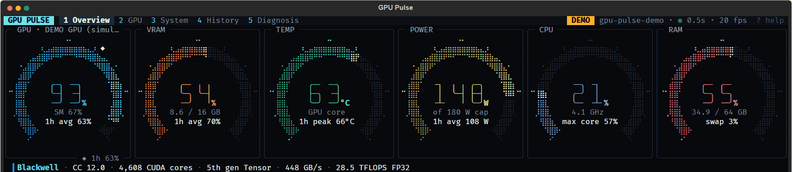

</div>

---

## Two tools, one project

| | **VS Code extension** | **Terminal dashboard (`gpu-pulse`)** |
|---|---|---|
| Where it runs | Inside VS Code, including on Linux GPU servers over Remote-SSH and WSL | Any terminal: local, SSH, tmux |
| Best for | Watching a training run while you code | Servers, quick checks, deep analysis |
| Live gauges and charts | ✅ Canvas dashboard | ✅ Animated braille ring gauges |
| **Apple Silicon / Metal** | ✅ GPU utilization and shared memory | ✅ GPU utilization and shared memory |
| 5 min / 30 min / 1 h / 24 h averages | ✅ | ✅ |
| 24-hour heatmap | ✅ | ✅ |
| **True usage** (SM, Tensor Core, DRAM activity) | — | ✅ |
| **Bottleneck diagnosis** and efficiency score | Basic insights | ✅ Full engine |
| System health (CPU, RAM, disk, network) | CPU and RAM | ✅ Everything |
| GPU architecture card | Specs | ✅ Cores, Tensor gen, bandwidth, TFLOPS, PCIe |
| Status bar / one-shot output | ✅ Status bar | ✅ `gpu-pulse status` |
| Pinned side-bar monitor | ✅ Activity Bar view, movable to the right side | n/a |
| Multiple GPUs | ✅ All-GPUs strip, aggregate status bar, cross-GPU insights | ✅ ALL GPUS panel, per-GPU diagnosis, cross-GPU findings |
| CPU cost (measured, see [Efficiency](#efficiency)) | ~0.2–0.6% of a core at 500 ms | ~5% on the Overview, ~0.5–1% on other tabs |

Both read the same kind of data, apply the same insight rules, and record history in a compatible per-minute format.

---

## Screenshots

### Terminal dashboard

<table>
<tr>
<td width="50%">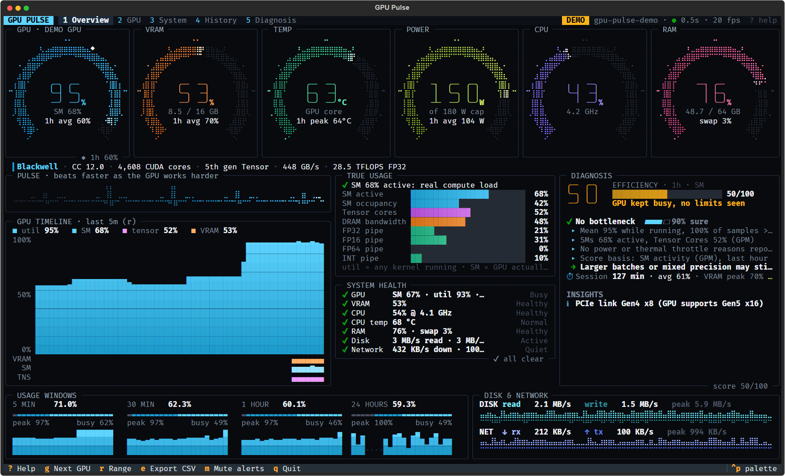<br><sub><b>Overview</b>: six live rings, pulse strip, timeline with SM and Tensor lines, true usage, health and diagnosis</sub></td>
<td width="50%">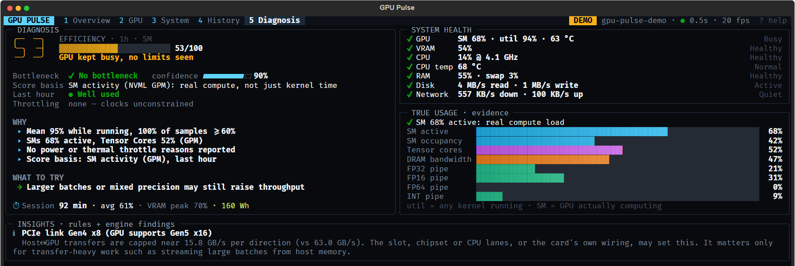<br><sub><b>Diagnosis</b>: efficiency score, bottleneck with confidence, evidence, what to try, session energy, and the <b>alerts</b> list (4-GPU demo)</sub></td>
</tr>
<tr>
<td>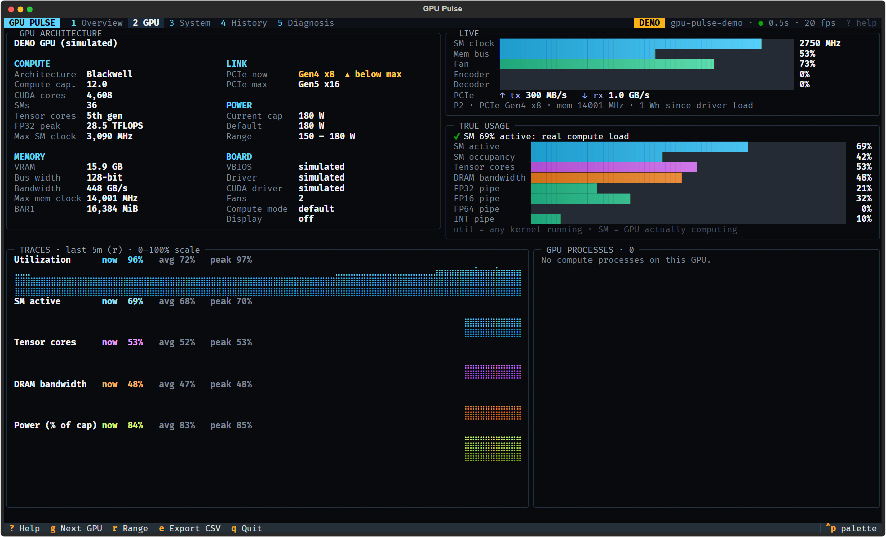<br><sub><b>GPU</b>: architecture card, clocks, encoder/decoder, PCIe throughput, per-metric traces, processes</sub></td>
<td>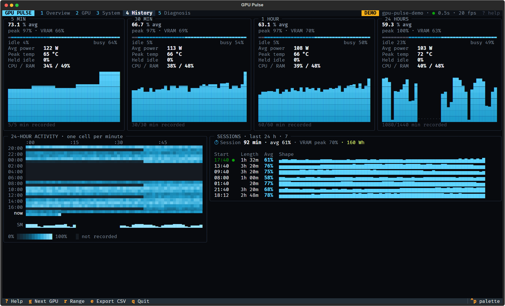<br><sub><b>History</b>: usage windows, 24-hour heatmap with SM activity, detected sessions</sub></td>
</tr>
</table>

<sub>Screenshots use <code>gpu-pulse --demo</code>, which simulates a training workload so that every panel has data.</sub>

### Multiple GPUs

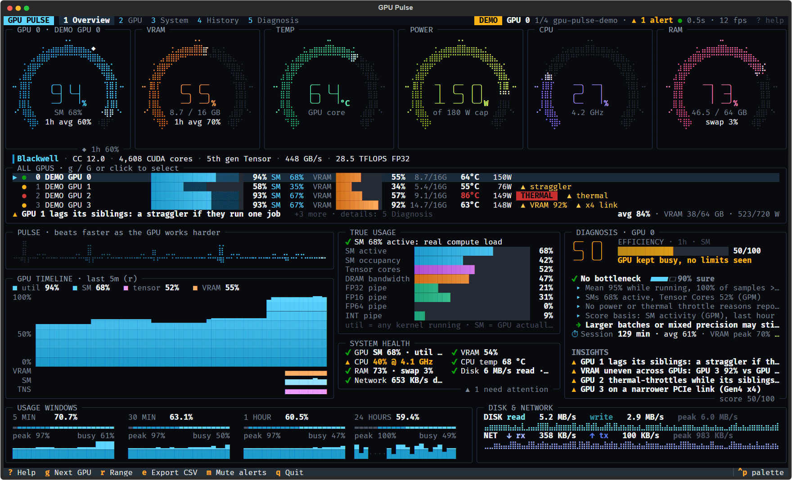
<sub><code>gpu-pulse --demo --demo-gpus 4</code>: the ALL GPUS panel flags GPU 1 as a possible straggler (if the GPUs run one job), GPU 2 as thermal-throttling on its own, and GPU 3 on a narrower PCIe link with 92% VRAM. The header shows the active alert count (GPU 2 running hot).</sub>

### VS Code extension

<table>
<tr>
<td width="50%">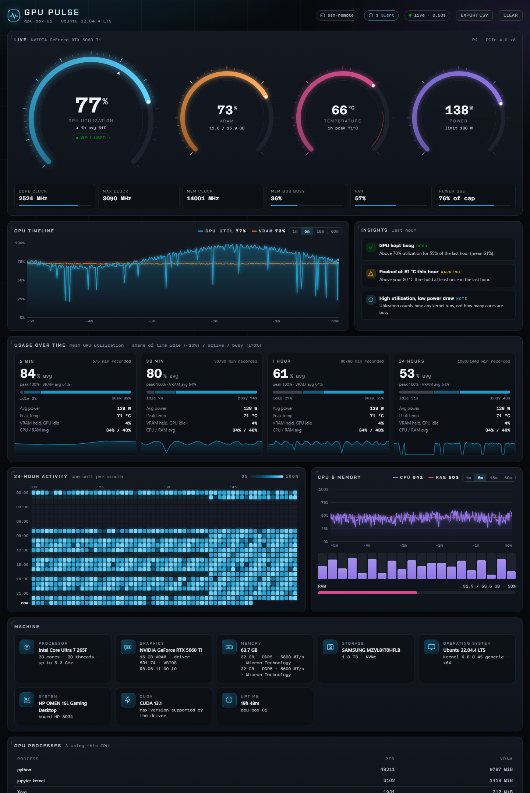</td>
<td width="50%">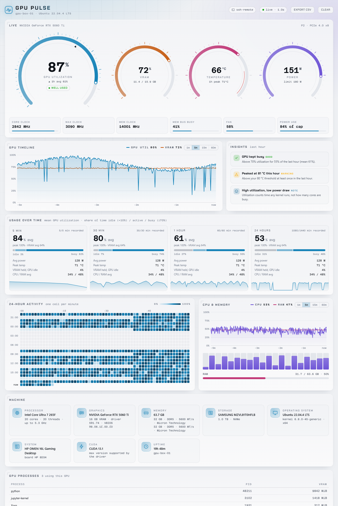</td>
</tr>
<tr><td colspan="2"><sub>Follows your VS Code theme. Shows live gauges, a timeline with hover readouts, usage windows, a 24-hour heatmap, insights, CPU and memory, processes and machine specs.</sub></td></tr>
<tr>
<td width="70%">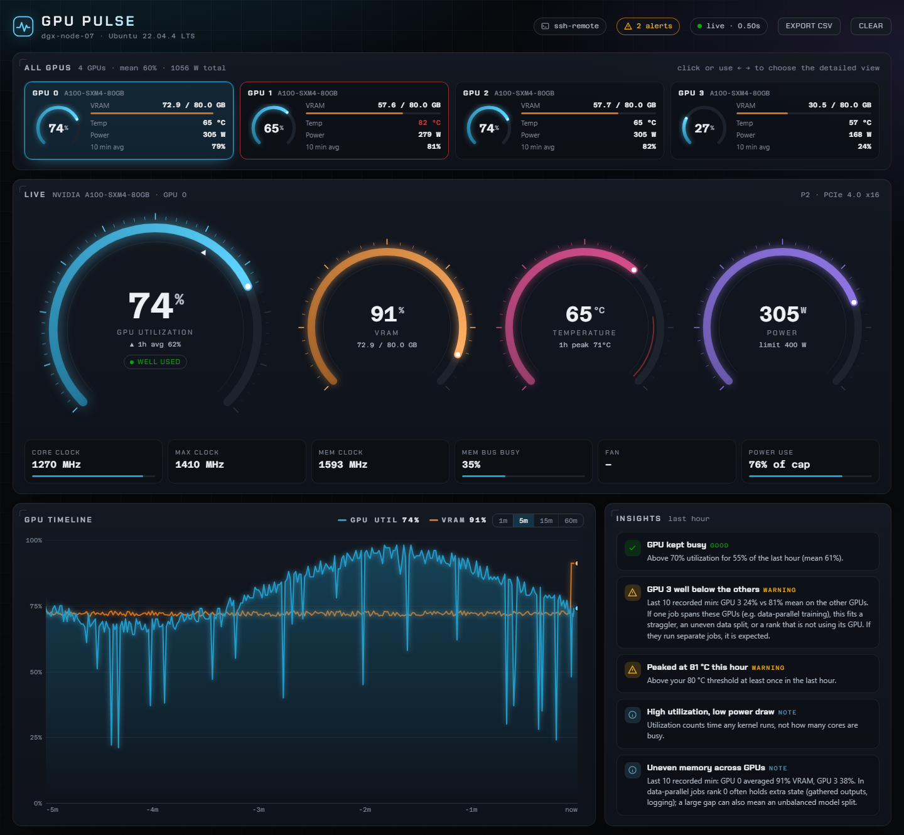<br><sub><b>All GPUs</b> strip with selectable cards; insights compare the GPUs; the header badge shows active alerts.</sub></td>
<td width="30%" valign="top">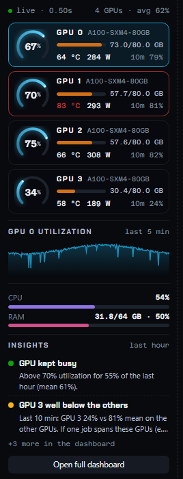<br><sub><b>Side bar</b>: pin it next to your editor or chat panel.</sub></td>
</tr>
</table>

### Apple Silicon / Metal

**Both dashboards now support Apple Silicon Macs.** GPU Pulse detects the GPU automatically and reads
utilization and shared GPU allocations through macOS `ioreg`, with no `sudo` or extra helper to install.

<table>
<tr>
<td width="50%">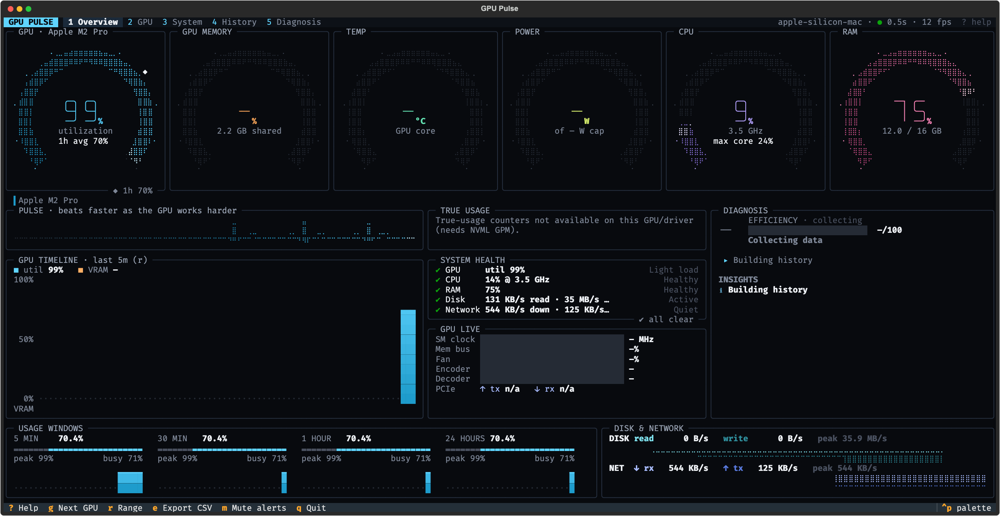<br><sub><b>Terminal</b>: real M2 Pro readings during a Metal compute workload.</sub></td>
<td width="50%">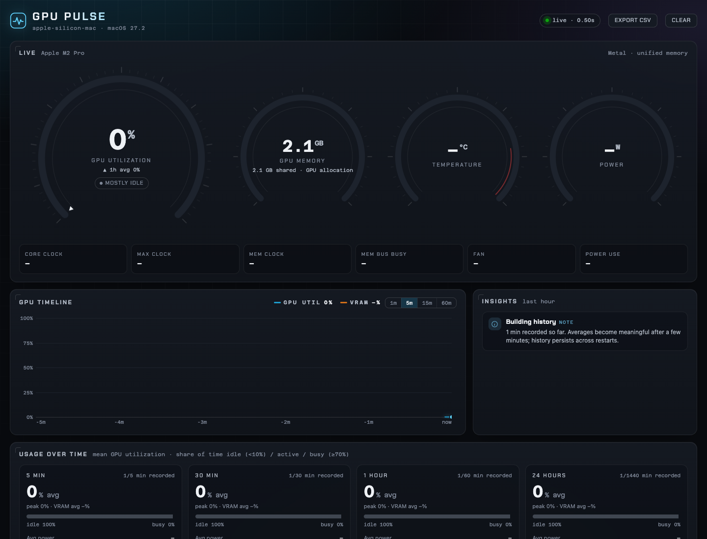<br><sub><b>VS Code dashboard</b>: real M2 Pro readings in the browser preview, with shared GPU memory and unavailable sensor values.</sub></td>
</tr>
</table>

| Apple Silicon feature | Terminal | VS Code |
|---|---|---|
| Live GPU utilization | ✅ | ✅ |
| Allocated GPU memory, labeled **shared** | ✅ | ✅ |
| Usage history, heatmap and CSV export | ✅ | ✅ |
| Job-finished alerts | ✅ | ✅ |
| CPU and RAM monitoring | ✅ | ✅ |
| GPU temperature, power, clocks and per-process usage | — | — |
| Dedicated VRAM capacity / percentage and NVIDIA GPM counters | — | — |

Validated on an **Apple M2 Pro** with a real Metal workload: utilization rose from **0% to 99%** and
returned to idle afterward. Shared system memory has no dedicated VRAM total, so memory-capacity alerts
stay unavailable. IORegistry counters are best effort and can vary by macOS version.

**Available on `main`; not included in the v0.3.0 release files.** Use the source install or build the
extension from the [Mac checkout instructions](#platform-support).

---

## Install

### From the latest release (recommended)

Download from **[Releases](https://github.com/Optimizer077/gpu-pulse/releases/latest)**:

| File | Install |
|---|---|
| `gpu-pulse-0.3.0.vsix` | `code --install-extension gpu-pulse-0.3.0.vsix`, or in VS Code: Extensions → `…` → **Install from VSIX…** |
| `gpu_pulse-0.3.0-py3-none-any.whl` | `pip install gpu_pulse-0.3.0-py3-none-any.whl` or `uv tool install gpu_pulse-0.3.0-py3-none-any.whl` |

You can also install the terminal tool straight from GitHub:

```bash
pip install "https://github.com/Optimizer077/gpu-pulse/releases/download/v0.3.0/gpu_pulse-0.3.0-py3-none-any.whl"
# or the latest source
pip install "git+https://github.com/Optimizer077/gpu-pulse.git#subdirectory=pip"
```

Each release includes `SHA256SUMS.txt` for checking the downloads.

### Requirements

- **NVIDIA GPU:** a driver that includes `nvidia-smi` / NVML. That's every standard NVIDIA driver on Windows and Linux.
- **True-usage metrics:** need NVML **GPM** support, which recent GPUs and drivers provide (verified on an RTX 50-series card under Windows). Without it, those panels say so; nothing breaks.
- **AMD:** Linux `amdgpu` driver (via `/sys/class/drm`), best effort.
- **Apple Silicon / Metal:** macOS on an Apple Silicon Mac, using built-in `ioreg`; available from `main`.
- **No GPU:** CPU, RAM, disk, network and specs still work.

---

## Quick start

```bash
gpu-pulse --demo     # preview every feature with simulated load
gpu-pulse            # live dashboard for your real GPU
gpu-pulse status     # one-shot snapshot (great over SSH)
```

In VS Code: open the Command Palette → **GPU Pulse: Open Dashboard**, or click `GPU 37% · 5.1/16 GB · 54°C` in the status bar.

**Pin it to the side:** click the GPU Pulse icon in the Activity Bar (or run **GPU Pulse: Show in Side Bar**). To keep it visible next to your editor or a chat panel, drag the view to the **Secondary Side Bar** on the right (View → Appearance → Secondary Side Bar).

---

## Features

### Live monitoring
- **Ring gauges** for GPU, VRAM, temperature, power, CPU and RAM. They resize with your terminal: 6 in a row, 3×2 or 2×3. They sweep on startup, ease between samples, and turn amber or red near your limits.
- **Pulse strip:** an ECG-style heartbeat that beats faster and taller as the GPU works harder.
- **Timeline** of utilization, SM activity, Tensor activity and VRAM over 1, 5, 15 or 60 minutes.
- **Detail:** clocks vs max, memory-bus load, fan, P-state, PCIe link, encoder/decoder use, PCIe TX/RX throughput.

### Usage over time
- **Windows:** 5 min, 30 min, 1 h and 24 h. Each shows mean and peak utilization, time **idle** (<10%) vs **busy** (≥70%), average power, peak temperature, and **VRAM held while idle**.
- **24-hour heatmap:** one cell per minute in clock-aligned rows, with your overnight gaps visible at a glance.
- **Sessions:** training runs are detected automatically, with duration, average utilization, peak VRAM and **energy used (Wh)**.
- **Persistent history:** saved per minute, survives restarts, merges safely when several windows or processes record at once, and exports to CSV.

### Multiple GPUs
- **Overview of every GPU at once:** cards (VS Code) or one line per GPU (terminal) with utilization (and SM activity in the terminal), VRAM, temperature, power, throttling and health. Select any GPU for its detailed view.
- **Aggregate status bar:** e.g. `GPU ×4 avg 67% · max 98% · hottest 71°C`, with a per-GPU tooltip.
- **Cross-GPU findings:** a GPU well below its siblings (possible straggler or uneven data split), uneven VRAM, one GPU throttling alone, a GPU on a narrower PCIe link. They're worded for the common case of one data-parallel job; separate jobs per GPU make the differences expected.
- **History and CSV export** are kept per GPU.

### Understanding the GPU
- **Architecture card:** Blackwell, Ada, Ampere and so on, compute capability, CUDA cores, SMs, Tensor Core generation, memory bus, bandwidth, FP32 TFLOPS, power limits, VBIOS, driver and CUDA version.
- **True usage**, **bottleneck diagnosis** and **system health** are covered below.

---

## Why "utilization" isn't enough

`nvidia-smi`'s **GPU utilization** is the share of time that *at least one kernel was running*. A tiny kernel that keeps a single SM busy reads **100%**, while 90% of the chip sits idle.

GPU Pulse reads NVIDIA's **GPU Performance Monitoring (GPM)** counters to show how much of the GPU is *actually* working:

| Metric | What it tells you |
|---|---|
| **SM active** | Share of time the streaming multiprocessors (the compute cores) were busy. **This is the number to watch.** |
| **SM occupancy** | How full each SM is with resident warps. Low occupancy means too little parallel work. |
| **Tensor Cores** | Whether matrix math is using the Tensor Cores (needed for fast mixed-precision training). |
| **DRAM bandwidth** | Share of peak memory bandwidth in use. High means memory-bound. |
| **FP32 / FP16 / FP64 / INT pipes** | Which kinds of math the kernels are doing. |

When utilization and SM activity disagree (for example *"util 95% but SM 15%"*), the dashboard flags it.

---

## Bottleneck diagnosis

The engine looks at the last 3 minutes of samples, at 0.5 s intervals. Every rule proposes an explanation with a confidence; the strongest wins, and the runner-up is shown as well. Each verdict comes with **evidence** and **what to try**.

| Verdict | What it means | Typical fixes it suggests |
|---|---|---|
| **No bottleneck** | Busy, steady, unthrottled | Larger batches or mixed precision may still help |
| **Input-bound** | Bursty: busy plateaus with gaps between steps | More `DataLoader` workers, `pin_memory`, prefetching |
| **Disk-bound** | Same gaps while disk reads run near their peak | Faster storage, caching decoded samples |
| **Network-bound** | Same gaps while network receive runs near its peak | Local caching, check the remote data source |
| **CPU-bound** | CPU saturated (or **one core pegged**) while the GPU waits | Move preprocessing to workers or the GPU, look for single-threaded steps |
| **Power-capped** | Clocks held down by the power limit | Expected at full load; mixed precision gives more work per watt |
| **Thermal-limited** | Clocks dropping from heat | Airflow, fan curve, a slightly lower power limit |
| **Memory-bound** | DRAM bandwidth ≥ 80% | Fuse ops, larger tiles, lower precision |
| **Low SM parallelism** | Utilization high but SMs mostly idle | Larger batches; profile for low-occupancy kernels |
| **VRAM held idle** | Memory allocated, GPU doing nothing | Free the notebook kernel / `torch.cuda.empty_cache()` |
| **RAM pressure** | System RAM nearly full or swapping | Fewer workers, smaller prefetch, more RAM |
| **Idle** | Nothing running | n/a |

### Efficiency score (0–100, last hour)

```
activity = SM activity / 80%   (or utilization / 100% when GPM isn't available)
score    = 100 × (0.6 × activity + 0.4 × busy share)
         − 30 × held-idle share − 10 × power-throttled share − 20 × thermal share − 15 × burstiness
```

The dashboard always shows which basis it used: **SM activity** or **utilization**.

### Also detected
- VRAM forecast, e.g. *"VRAM full in ~6 min at current rate"*
- PCIe link running below its maximum (e.g. Gen4 x8 on a Gen5 x16 card)
- Tensor Cores idle during heavy FP32 work, which suggests enabling AMP, bf16 or TF32
- Sudden utilization collapse mid-session, clocks well below max with no throttle reason, temperature climbing fast

---

## Alerts

Both tools watch for four situations and notify you once. An alert then stays quiet until its condition clears, and repeats at most every 30 minutes per GPU:

| Alert | Fires when | Clears when |
|---|---|---|
| **Running hot** | GPU temperature ≥ your warning threshold for 30 s | 3 °C below the threshold |
| **VRAM nearly full** | VRAM ≥ 95% for 20 s | below 90% |
| **VRAM held while idle** | utilization < 10% while VRAM ≥ 50%, for 15 min (configurable) | utilization ≥ 15% or VRAM < 40% |
| **Job finished** | a busy stretch of ≥ 10 min (configurable) ends: GPU idle for 60 s. Shows the duration and average utilization | next job |

- **VS Code:** notifications with **Open Dashboard** and **Mute 1 hour**. Each alert type can be turned off under `gpuPulse.alerts.*`. Alerts keep working while the dashboard is closed, as long as sampling runs (status bar or background recording on).
- **Terminal:** pop-up toasts in the dashboard, plus a list on the Diagnosis tab; `m` mutes for an hour.
  - Options: `--no-alerts`, `--bell`, `--idle-held-min`, `--job-min`.
  - `gpu-pulse log --alerts` prints alerts with no UI open. Add `--notify` for desktop notifications on Linux (`notify-send`).

---

## Efficiency

A monitor shouldn't cost much of what it measures. These figures come from one machine (RTX 5060 Ti, Core Ultra 7 265F, Windows 11) and are expressed as a share of one CPU core. Yours will differ.

| | 0.1.0 | 0.2.0 | How |
|---|---|---|---|
| VS Code extension, sampling at 500 ms | ~5.7% (at 1 s) | **~0.2–0.6%** | One long-lived `nvidia-smi -lms` stream instead of a new process per sample; analysis at most every 2 s; DOM and canvas updates only on change |
| Terminal dashboard, Overview, idle GPU (rings settled; pulse strip still animating) | ~57% | **~5%** (3.5–6.7%) | Rings stop redrawing once they reach their value; a ring only shimmers after a visible move; only changed rows repaint |
| Terminal dashboard, Overview, 4 GPUs, everything moving (demo) | ~65% | **~5–10%** | Direct line rendering with cached styles, 12 fps default |
| Terminal dashboard, other tabs | ~2% | **~0.5–1%** | Animation pauses off the Overview |

Most of the terminal Overview's remaining cost is the always-animating pulse strip; a lower `--fps` reduces it.

Reproduce: `npm run bench` (extension sampler) and `cd pip && uv run --with psutil python scripts/bench.py` (terminal dashboard). Lower `--fps` (or `--fps 0`) and a larger `gpuPulse.sampleIntervalMs` reduce cost further.

---

## Usage

### Terminal dashboard (`gpu-pulse`)

| Command | What it does |
|---|---|
| `gpu-pulse` | Full-screen live dashboard |
| `gpu-pulse status` | One-shot snapshot, for SSH and scripts |
| `gpu-pulse log [-i 5]` | Background recorder with no UI, so averages also cover time the dashboard was closed |
| `gpu-pulse export [file.csv]` | Per-minute history as CSV (to stdout if no file is given) |
| `gpu-pulse clear` | Delete recorded history |
| `gpu-pulse where` | Print the history file location |

| Option | Default | Meaning |
|---|---|---|
| `-i, --interval` | `0.5` | Seconds between samples (minimum 0.1) |
| `--fps` | `12` | Animation frame rate; `0` turns animation off, which helps on slow SSH links |
| `--demo` | off | Simulated GPU load; nothing is saved and the real host name is hidden |
| `--demo-gpus N` | `1` | With `--demo`: simulate N GPUs (1–16), including a straggler |
| `--history PATH` | per-user data dir | Custom history file |
| `--temp-warn` | `80` | Temperature warning threshold (°C) |

**Keys:** `1`–`5` or `←`/`→` switch tabs (Overview, GPU, System, History, Diagnosis) · `?` help with metric definitions · `g` / `G` next / previous GPU (or `g` then a GPU number, or click a GPU line) · `r` timeline range · `e` export CSV · `q` quit

#### Record history all the time

<details>
<summary><b>Linux (systemd user service)</b></summary>

```ini
# ~/.config/systemd/user/gpu-pulse.service
[Unit]
Description=GPU Pulse usage logger

[Service]
ExecStart=%h/.local/bin/gpu-pulse log -i 5
Restart=on-failure

[Install]
WantedBy=default.target
```

```bash
systemctl --user enable --now gpu-pulse
```
</details>

<details>
<summary><b>Windows (Task Scheduler)</b></summary>

```powershell
$action  = New-ScheduledTaskAction -Execute "$env:USERPROFILE\.local\bin\gpu-pulse.exe" -Argument "log -i 5"
$trigger = New-ScheduledTaskTrigger -AtLogOn
Register-ScheduledTask -TaskName "GPU Pulse logger" -Action $action -Trigger $trigger
```
</details>

The dashboard and the logger can run at the same time. Saves merge per minute under a lock file and are written atomically.

### VS Code extension

| Command | What it does |
|---|---|
| **GPU Pulse: Open Dashboard** | Open the live dashboard (also: click the status bar item) |
| **GPU Pulse: Show in Side Bar** | Reveal the compact pinned view (drag it to the Secondary Side Bar to keep it on the right) |
| **GPU Pulse: Export Usage History (CSV)** | Save per-minute history |
| **GPU Pulse: Clear Usage History** | Delete recorded history (asks first) |

| Setting | Default | Meaning |
|---|---|---|
| `gpuPulse.sampleIntervalMs` | `500` | Sampling interval while the dashboard or side bar is visible (minimum 250) |
| `gpuPulse.backgroundIntervalMs` | `5000` | Sampling interval while both are hidden |
| `gpuPulse.recordInBackground` | `true` | Keep recording while the dashboard is closed (turn off on laptops so the GPU can sleep) |
| `gpuPulse.historyDays` | `7` | Days of per-minute history to keep |
| `gpuPulse.statusBar.enabled` | `true` | Show `GPU % · VRAM · °C` in the status bar |
| `gpuPulse.nvidiaSmiPath` | `""` | Custom `nvidia-smi` path |
| `gpuPulse.temperatureWarning` | `80` | Warning threshold (°C) |

**Remote-SSH and WSL:** the extension runs on the machine that owns the GPU (`extensionKind: workspace`), so it monitors the remote server, not your laptop.

---

## How it works

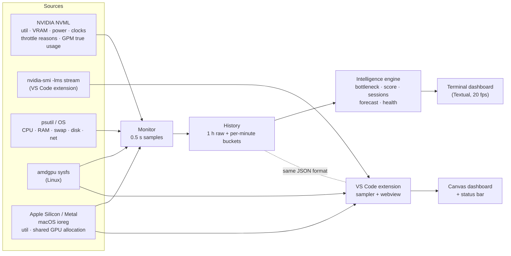

| | Terminal dashboard | VS Code extension |
|---|---|---|
| GPU data | NVML via `nvidia-ml-py` (≈0.1 ms per GPU per sample incl. GPM) | One long-lived `nvidia-smi --query-gpu … -lms` stream (auto-restart, polling fallback) |
| Apple Silicon / Metal data | ✅ macOS `ioreg`: GPU utilization and shared GPU allocation | ✅ Same source, sampled by the extension host |
| UI | Textual + Rich, braille ring gauges drawn as cached line strips | Webview (dashboard tab + side-bar view), Canvas 2D, bundled fonts, no CDN |
| History file | `%LOCALAPPDATA%\gpu-pulse\history.json` (Windows), `~/.local/share/gpu-pulse/history.json` (Linux), `~/Library/Application Support/gpu-pulse/history.json` (macOS) | VS Code global storage on the GPU machine |

**Privacy:** everything stays on your machine. No telemetry, no network calls. The serial number is never read.

---

## Platform support

| GPU | Windows | Linux | macOS | Remote-SSH / WSL |
|---|---|---|---|---|
| NVIDIA | ✅ Full (per-process VRAM hidden by WDDM) | ✅ Full | — | ✅ |
| AMD | Specs only | ✅ Utilization, VRAM, power, temperature (best effort) | — | ✅ (Linux host) |
| Apple Silicon / Metal | — | — | ✅ Utilization and allocated GPU memory | ✅ (Mac SSH host) |
| None | CPU / RAM / disk / net / specs | Same | Same | Same |

Both tools detect Apple Silicon automatically using macOS `ioreg`, with no administrator privileges,
compiled helper or extra dependencies. GPU allocation is shown as **shared memory**. Physical RAM is not
reported as dedicated VRAM capacity, and VRAM percentages and capacity alerts remain unavailable.
Temperature, power, clocks, NVIDIA GPM and per-process GPU usage are unavailable from this backend.
Utilization, job-finished alerts, history, CSV export and CPU/RAM monitoring work normally. Counters are best
effort and vary by driver/macOS version. Intel and AMD GPUs on macOS are not supported.

To test a source checkout on a Mac:

```bash
python3 -m venv .venv
.venv/bin/python -m pip install -e ./pip
.venv/bin/gpu-pulse status
.venv/bin/gpu-pulse
# VS Code extension (requires Node.js/npm)
npm ci
npm run smoke
GPU_PULSE_EXPECT_VENDOR=apple npm run test:integration
npm run package  # install the resulting .vsix through VS Code's Extensions menu
```

---

## FAQ / troubleshooting

<details>
<summary><b>The true-usage panel says "not available".</b></summary>

GPM counters need a recent NVIDIA GPU and driver. Older cards still get utilization, VRAM, power, clocks and throttle reasons. The diagnosis then falls back to utilization and says so.
</details>

<details>
<summary><b>Per-process VRAM shows "n/a" on Windows.</b></summary>

The Windows display driver model (WDDM) doesn't report per-process GPU memory to NVML or `nvidia-smi`. On Linux it's shown.
</details>

<details>
<summary><b>The averages only cover part of the day.</b></summary>

History is recorded while a dashboard is open. Run `gpu-pulse log` (see [Record history all the time](#record-history-all-the-time)), or keep `gpuPulse.recordInBackground` on in VS Code.
</details>

<details>
<summary><b>It says the PCIe link is below maximum.</b></summary>

The card reports what it supports and what it's running at. Some cards are wired x8, and slots or chipsets can limit the link. This only matters for transfer-heavy work, such as streaming large batches from host memory.
</details>

<details>
<summary><b>Animations are choppy over SSH.</b></summary>

Use `gpu-pulse --fps 10`, or `--fps 0` to turn animation off. Values still update every sample.
</details>

---

## Development

```
.
├── src/, media/, test/     VS Code extension (TypeScript, esbuild, vitest)
├── pip/                    Terminal dashboard (Python, Textual, uv)
│   ├── src/gpu_pulse/      collectors, history, intelligence engine, UI
│   └── tests/              227 tests
├── scripts/                preview page, icon, smoke test
└── docs/images/            README visuals
```

```bash
# VS Code extension
npm install
npm run build && npm test          # unit tests
npm run test:integration           # runs inside a real VS Code
npm run package                    # -> gpu-pulse-<version>.vsix

# Terminal dashboard
cd pip
uv sync
uv run pytest && uv run ruff check src tests && uv run mypy src
uv run gpu-pulse --demo
uv build                           # -> dist/*.whl, *.tar.gz
```

Open `scripts/preview.html` in a browser to iterate on the VS Code dashboard with synthetic data (add `?light` for the light theme).

## Roadmap

- True-usage metrics and the full diagnosis engine in the VS Code extension
- Alerts, such as "GPU idle for 15 min while VRAM is held" or "training job finished"
- Per-process GPU attribution on Linux (which PID uses how much SM / VRAM)
- Publish to the VS Code Marketplace and PyPI
- Intel Arc / AMD utilization on Windows

## License

MIT. See the `LICENSE` file. The bundled fonts (Chakra Petch and Azeret Mono) are under the SIL Open Font License 1.1; see `media/fonts/`.
